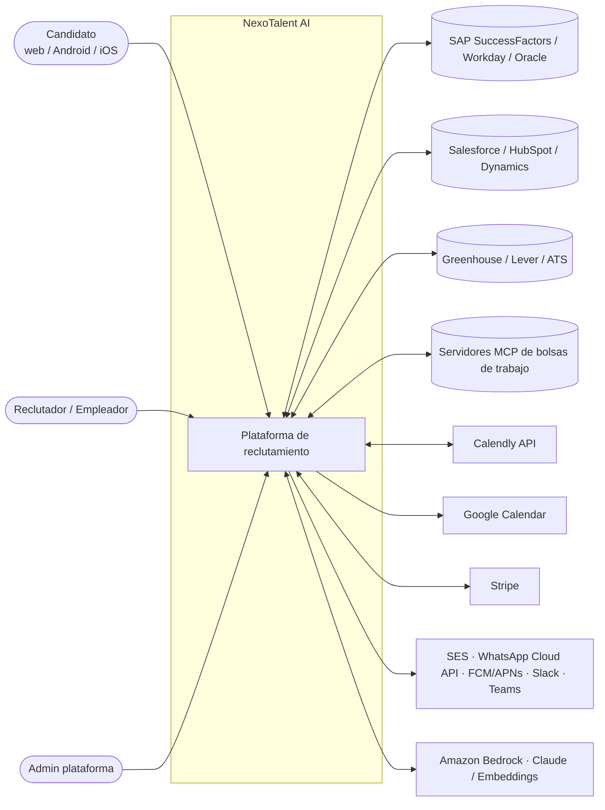
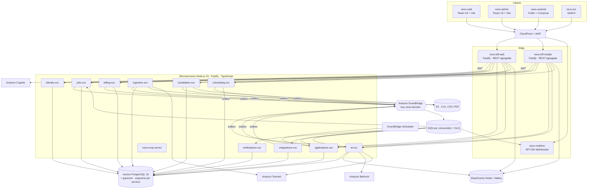

# 02 · Arquitectura del sistema

## 1. Estilo arquitectónico

NexoTalent AI combina cuatro patrones:

1. **Microservicios por *bounded context*** (DDD): cada servicio es dueño de sus datos (*database-per-service* lógico: un esquema PostgreSQL por servicio en un clúster Aurora compartido en MVP).
2. **Arquitectura orientada a eventos (EDA):** los servicios se comunican de forma asíncrona por **Amazon EventBridge** (bus de dominio) con **SQS** por consumidor y DLQ. Se usa el **patrón Outbox** para garantizar consistencia entre la base de datos y la publicación de eventos.
3. **BFF (Backend for Frontend):** un BFF web y uno móvil agregan datos para cada pantalla en **una sola llamada**, reducen *chattiness* y aplican caché.
4. **Hexagonal (Ports & Adapters)** dentro de cada servicio y una **capa anticorrupción (ACL)** para integraciones externas (SAP, CRMs, ATS, MCP).

La IA no es un módulo aislado: es un **plano transversal** (AI Plane) con gateway de LLM, RAG, embeddings y agentes, consumido por varios servicios (ver [03-arquitectura-ai.md](03-arquitectura-ai.md)).

## 2. Diagrama de contexto (C4 nivel 1)

## 3. Diagrama de contenedores (C4 nivel 2)

## 4. Servicios y responsabilidades

| Servicio | Responsabilidad | Eventos que publica | Eventos que consume |
|---|---|---|---|
| `identity-svc` | Usuarios, organizaciones, membresías, roles, API keys. Federación con Cognito. | `user.registered`, `org.created`, `member.invited` | — |
| `jobs-svc` | Vacantes, skills requeridas, estados, posiciones, contadores (`positions_total`, `positions_filled`, `applicants_count`). | `job.published`, `job.status_changed`, `job.updated` | `application.submitted`, `application.status_changed` (contadores), `payment.succeeded`, `import.job_parsed` |
| `candidates-svc` | Perfil, CV, skills declaradas y extraídas, preferencias, reglas de auto-apply. | `candidate.profile_updated`, `resume.uploaded` | `ai.resume_parsed` |
| `applications-svc` | Postulaciones, pipeline, historial de estatus, mensajes, auto-apply, detección de estancamiento. | `application.submitted`, `application.status_changed`, `application.stale`, `application.message_posted` | `ai.match_computed`, `interview.scheduled`, `job.status_changed` |
| `ai-svc` | LLM gateway, embeddings, matching, RAG, parsing de CV/vacantes, agentes. | `ai.resume_parsed`, `ai.job_parsed`, `ai.match_computed` | `resume.uploaded`, `job.published`, `candidate.profile_updated` |
| `ingestion-svc` | Ingesta 1..N: API, endpoint registrado (pull), CSV, PDF; validación, preview, deduplicación. | `import.started`, `import.job_parsed`, `import.completed` | — |
| `integrations-svc` | Conectores SAP, CRMs, ATS, clientes MCP; sincronización bidireccional de estatus. | `integration.job_received`, `integration.sync_failed` | `application.status_changed`, `job.status_changed` |
| `scheduling-svc` | Calendly OAuth, links de agenda, webhooks, feed ICS, Google Calendar. | `interview.scheduled`, `interview.canceled`, `interview.completed` | `application.status_changed` (a "Preseleccionado") |
| `notifications-svc` | Orquestación omnicanal, plantillas, preferencias, *quiet hours*, deduplicación. | `notification.sent`, `notification.failed` | Casi todos los eventos de dominio |
| `billing-svc` | Planes, créditos, Stripe Checkout/Payment Intents, webhooks, facturas. | `payment.succeeded`, `subscription.changed`, `credit.consumed` | `job.publish_requested` |
| `nexo-mcp-server` | Expone la plataforma como **servidor MCP** (tools para agentes internos y de clientes). | — | — |
| `nexo-realtime` | Push in-app por WebSocket (API Gateway WebSocket + Lambda). | — | `notification.*` |

## 5. Optimización de llamadas del backend

| Técnica | Dónde | Efecto |
|---|---|---|
| **Endpoints agregados por pantalla** (`GET /bff/candidate/dashboard`) | BFF | 1 request por pantalla en lugar de 5–8. |
| **Llamadas paralelas** (`Promise.all`) y **undici** con keep-alive | BFF → servicios | Latencia = máx(llamadas), no suma. |
| **DataLoader** por request | BFF | Elimina N+1 al resolver vacantes/empresas de una lista. |
| **Read models CQRS** (proyecciones) | `applications-svc`, `jobs-svc` | Dashboards leen tablas desnormalizadas, sin joins costosos. |
| **Caché Redis** con *stale-while-revalidate* + invalidación por evento | BFF, `ai-svc` | Vacantes públicas y scores de match en caché; se invalida con `job.updated`. |
| **ETag / 304** y `Cache-Control` | BFF, CloudFront | Respuestas condicionales para listados públicos. |
| **Paginación por cursor** (keyset) | Todos los listados | Rendimiento constante en páginas profundas. |
| **Selección de campos** (`?fields=`) | BFF | Payloads más pequeños en móvil. |
| **Compresión Brotli** + HTTP/2 | CloudFront | Menos bytes en red. |
| **WebSocket / SSE** en vez de *polling* | Notificaciones, streaming de IA | Sin peticiones repetitivas. |
| **Contadores desnormalizados** (`applicants_count`) actualizados por evento | `jobs-svc` | Evita `COUNT(*)` por listado. |
| **Batch de embeddings** y **prompt caching** | `ai-svc` | Menor costo y latencia del LLM. |
| **Índices HNSW** en pgvector + filtros previos | `ai-svc` | Búsqueda vectorial < 50 ms p95. |

## 6. Estructura polyrepo

| Repositorio | Tipo | Contenido |
|---|---|---|
| `nexo-workspace` | Meta-repo | `repos.yaml`, scripts de clonado, `docker-compose` local, AGENTS.md global. |
| `nexo-specs` | Contratos | OpenSpec (`openspec/`), OpenAPI, AsyncAPI, JSON Schemas de eventos, ADRs, docs. |
| `nexo-harness` | Harness IA | Skills, hooks, subagentes, comandos y plantillas AGENTS.md compartidas. |
| `nexo-ui` | Librería | Design system React (tokens, componentes, charts), Storybook. Publicado en GitHub Packages. |
| `nexo-web` | Frontend | Portal candidato + empleador (React 19, Vite, TanStack Router/Query). |
| `nexo-admin` | Frontend | Panel de administración de plataforma. |
| `nexo-bff-web`, `nexo-bff-mobile` | Backend | BFFs Fastify. |
| `nexo-<dominio>-svc` (×10) | Backend | Microservicios Node.js. |
| `nexo-mcp-server` | Backend | Servidor MCP (TypeScript SDK). |
| `nexo-shared-node` | Librería | Logger, OTel, outbox, cliente EventBridge, errores, auth middleware. |
| `nexo-infra` | IaC | AWS CDK (TypeScript): redes, datos, cómputo, CI/CD. |
| `nexo-evals` | Calidad IA | Datasets, evals de matching/RAG/agentes y evals del harness. |
| `nexo-android`, `nexo-ios` | Móvil (fase 2) | Apps nativas. |

**Coordinación entre repos:** los contratos viven solo en `nexo-specs`; los servicios generan tipos con `openapi-typescript` y validan eventos contra JSON Schema en CI. Cambios transversales se hacen con un *change proposal* de OpenSpec que lista los repos afectados, y PRs enlazados por la misma etiqueta `change/<id>`.

## 7. Decisiones de arquitectura (ADRs)

| ADR | Decisión | Alternativas | Razón |
|---|---|---|---|
| 001 | Polyrepo con repo de contratos | Monorepo (Nx/Turbo) | Requisito del curso; despliegue y permisos independientes; obliga a contratos explícitos. |
| 002 | EventBridge + SQS | Kafka (MSK), SNS | Serverless, sin operación de clúster, reglas por contenido, Scheduler integrado. |
| 003 | Aurora PostgreSQL + pgvector | OpenSearch, Pinecone | Un solo motor para relacional y vectores; filtros SQL + ANN en una consulta; menor costo. |
| 004 | Amazon Bedrock (Claude + embeddings) | API directa de proveedores | Datos dentro de la cuenta AWS, IAM, sin salida de PII a terceros, facturación unificada. |
| 005 | Fastify + TypeScript | Express, NestJS | Rendimiento, validación por JSON Schema nativa, ligero. |
| 006 | ECS Fargate para servicios, Lambda para workers puntuales | EKS | Menor complejidad operativa. |
| 007 | Outbox + consumidores idempotentes | Publicación directa | Evita eventos perdidos/duplicados ante fallos. |
| 008 | Drizzle ORM | Prisma, TypeORM | Soporte nativo de `vector`, SQL explícito, migraciones versionadas. |
| 009 | BFF por canal | GraphQL federado | Simplicidad, caché HTTP, pantallas bien definidas. |

## 8. Beneficios y sacrificios

**Beneficios:** escalado independiente (el `ai-svc` y `ingestion-svc` tienen cargas muy distintas), aislamiento de fallos (si Slack falla, la postulación no falla), extensibilidad de integraciones sin tocar el núcleo, trazabilidad completa por eventos (auditoría de IA y cumplimiento).

**Sacrificios:** mayor complejidad operativa y de pruebas (contratos, consistencia eventual), más costo base que un monolito, *debugging* distribuido (mitigado con OpenTelemetry y `correlation_id`). **Mitigación para el proyecto del curso:** el MVP puede desplegar varios servicios en un mismo *task* de ECS (*modular deployment*) manteniendo los límites de código y datos.
