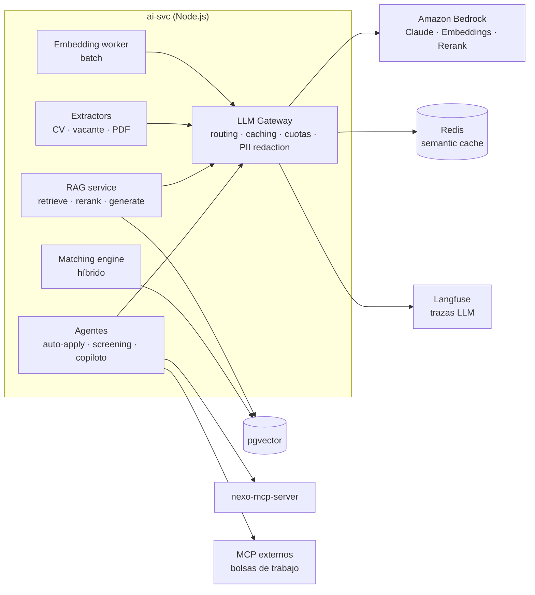

# 03 · Arquitectura de IA (LLM, RAG, MCP y agentes)

## 1. AI Plane



### 1.1 LLM Gateway
- **Model routing:** modelo ligero (familia Claude Haiku) para extracción estructurada y clasificación; modelo de razonamiento (familia Claude Sonnet) para resúmenes, copiloto RAG y agentes. Configurable por `feature_flag`.
- **Structured outputs:** toda extracción usa *tool use* con JSON Schema validado por Zod; si falla la validación, 1 reintento con el error como feedback y luego `needs_review`.
- **Prompt caching** del *system prompt* y de la taxonomía de skills.
- **Semantic cache** en Redis (hash del input normalizado + similitud > 0.97) para preguntas repetidas del copiloto.
- **PII redaction** previa (nombre, email, teléfono, CURP, RFC, dirección) con regex + NER; se reinyecta solo en la respuesta al usuario autorizado.
- **Cuotas y costo:** tokens por organización y plan; métricas `llm_tokens_total{feature,model}`.
- **Prompts versionados** en `nexo-specs/prompts/*.md` con id y versión; cada traza guarda `prompt_version`.

## 2. Extracción de skills

### 2.1 CV (candidato)
1. `resume.uploaded` → `ai-svc` descarga de S3 (presigned).
2. Texto: `pdf-parse`/`mammoth` para PDF/DOCX nativos; **Textract** si es escaneado.
3. LLM extrae `{experience[], education[], skills[{name, years, level 0-5, evidence}], languages[], summary}`.
4. **Normalización:** cada skill se embebe y se asocia a la taxonomía (`skills`, basada en ESCO/O*NET + tecnologías) por vecino más cercano (umbral 0.85; si no, `skill_candidate` para revisión del admin).
5. Se publica `ai.resume_parsed`; el candidato **confirma o corrige** las skills (*human-in-the-loop*).

### 2.2 Vacante
Igual flujo sobre la descripción: `required_skills[{skill_id, level, weight, must_have}]`, seniority, modalidad, rango salarial, ubicación. Un PDF puede contener **N vacantes**: el LLM primero segmenta (`split_jobs`) y luego extrae cada una.

### 2.3 Mejora de CV
- **Modo importación:** sugiere reescrituras con verbos de acción y métricas (método STAR), detecta huecos y skills implícitas.
- **Modo guiado:** wizard de 5 pasos (datos, experiencia, educación, skills, resumen) donde la IA propone viñetas a partir de respuestas cortas.
- Exporta PDF con plantilla ATS-friendly (sin tablas ni columnas).
- **Nunca inventa** experiencia: todas las sugerencias se marcan como propuesta y requieren aceptación.

## 3. Matching híbrido

Para candidato *c* y vacante *j*:

```
score(c, j) = 0.45 · skill_coverage(c, j)
            + 0.30 · cosine(emb_profile(c), emb_job(j))
            + 0.15 · seniority_fit(c, j)
            + 0.10 · preference_fit(c, j)      # ubicación, modalidad, salario
            − penalty(must_have faltantes)
```

- `skill_coverage = Σ_k w_k · min(level_c,k / level_j,k, 1) / Σ_k w_k`.
- **Pre-filtro SQL** (país, modalidad, estado `published`) + **ANN HNSW** (top 200) + **re-ranking** con la fórmula completa.
- **Atributos protegidos excluidos** del cálculo: género, edad, estado civil, foto, nacionalidad, dirección exacta.
- Resultado cacheado en `match_scores` y en Redis (TTL 24 h, invalidación por `job.updated` o `candidate.profile_updated`).

### 3.1 Datos para la gráfica de radar
Las skills se agrupan en **6–8 ejes** (categorías de la taxonomía: Lenguajes, Frameworks, Cloud, Datos, Soft skills, Idiomas, Dominio, Herramientas). Por eje: `required = promedio ponderado del nivel requerido`, `candidate = promedio del nivel del candidato` (0–5). El endpoint devuelve también `gaps[]` y `strengths[]` para la explicación textual.

## 4. RAG

| Caso | Corpus | Usuario |
|---|---|---|
| **Copiloto del reclutador** | CVs y postulaciones de *sus* vacantes, notas, scorecards | Reclutador |
| **Asistente del candidato** | Vacantes publicadas, info de empresa, FAQ del proceso | Candidato |
| **Soporte admin** | Documentación, políticas, logs de integración | Admin |

**Pipeline:** chunking por sección (experiencia, proyecto, requisito) de 300–500 tokens con *overlap* 10 % → embeddings 1024-d → tabla `rag_chunks` con `tenant_id`, `acl` y metadatos → **búsqueda híbrida** (BM25 con `tsvector` + vector, *Reciprocal Rank Fusion*) → **rerank** (Bedrock Rerank) → generación con **citas obligatorias** `[doc_id]`.

**Aislamiento multi-tenant:** filtro `tenant_id` y `acl` aplicado **en SQL** (Row Level Security), nunca en el prompt.

## 5. MCP

### 5.1 `nexo-mcp-server` (servidor propio)
Expuesto con el SDK oficial de TypeScript, transporte *Streamable HTTP* con OAuth 2.1. Tools:

| Tool | Descripción | Rol |
|---|---|---|
| `search_jobs` | Búsqueda semántica con filtros | candidate, agente |
| `get_job_match` | Score y radar de un candidato vs. vacante | candidate, recruiter |
| `apply_to_job` | Postula (requiere consentimiento vigente) | agente auto-apply |
| `list_applications` | Postulaciones y estatus | candidate, recruiter |
| `update_application_status` | Cambia estatus con motivo | recruiter |
| `create_job` / `import_jobs` | Alta 1..N vacantes | recruiter, integración |
| `close_job` | `filled` / `cancelled` / `on_hold` | recruiter |
| `schedule_interview` | Genera link Calendly | recruiter |

Resources: `job://{id}`, `candidate-profile://me`. Permite que clientes empresariales conecten **sus propios agentes** (p. ej. un asistente corporativo) a NexoTalent.

### 5.2 Clientes MCP (consumo)
`integrations-svc` incluye un **MCP client registry**: el admin registra servidores MCP de proveedores de vacantes o bolsas de trabajo (URL, auth, mapeo de tools → modelo canónico). Un adaptador genérico invoca `list/search` periódicamente o por demanda y normaliza al esquema canónico `CanonicalJob`. También permite **publicar** (multiposting) si el proveedor expone una tool de alta.

## 6. Agentes

| Agente | Disparador | Herramientas | Límites |
|---|---|---|---|
| **Auto-apply** | `job.published` + reglas activas del candidato | `get_job_match`, `apply_to_job`, generador de nota de presentación | Umbral de match ≥ regla (default 75 %), máx. N/día, nunca a empresas bloqueadas, bitácora visible, *kill switch*. |
| **Screening assistant** | `application.submitted` | RAG, scorecard template | Solo genera resumen y preguntas sugeridas; **no** rechaza ni avanza estatus. |
| **Copiloto reclutador** | Chat | RAG, `list_applications`, `schedule_interview` | Acciones con efecto requieren confirmación del usuario. |
| **Import agent** | PDF/CSV ambiguo | extractores, validador | Marca `needs_review` si confianza < 0.8. |

Orquestación: bucle *tool use* con máximo de 8 iteraciones, presupuesto de tokens por ejecución y registro en `ai_audit_log`.

## 7. Guardrails de IA (producto)
- Validación de entrada: tamaño, tipo MIME, antivirus (ClamAV en Lambda) para archivos.
- Defensa contra *prompt injection* en CVs y PDFs: el contenido de documentos va en bloques delimitados como **datos**, el *system prompt* lo declara no confiable y las tools con efecto no se exponen durante extracción.
- Filtro de salida: sin atributos protegidos ni lenguaje discriminatorio (clasificador + lista), sin PII de terceros.
- Explicabilidad: todo score muestra los factores.
- Revisión humana obligatoria en decisiones de estatus.

## 8. Evals de IA (producto)

| Eval | Dataset | Métrica | Umbral CI |
|---|---|---|---|
| Extracción de skills de CV | 150 CVs anotados | F1 por skill | ≥ 0.85 |
| Extracción de vacantes (PDF multi-vacante) | 40 PDFs | Exactitud de segmentación / campos | ≥ 0.90 |
| Matching | 300 pares etiquetados | Precision@10, nDCG@10 | ≥ 0.70 |
| RAG copiloto | 100 preguntas doradas | Faithfulness, context recall, citas válidas | ≥ 0.85 |
| Sesgo | Pares contrafactuales (cambio de nombre/género) | Δ score | ≤ 0.02 |
| Injection | 50 documentos maliciosos | Tasa de ataque exitoso | 0 % |

Herramientas: **promptfoo** para prompts, scripts propios en `nexo-evals` y trazas en Langfuse. Se ejecutan en CI ante cambios en `prompts/` o `ai-svc`.
