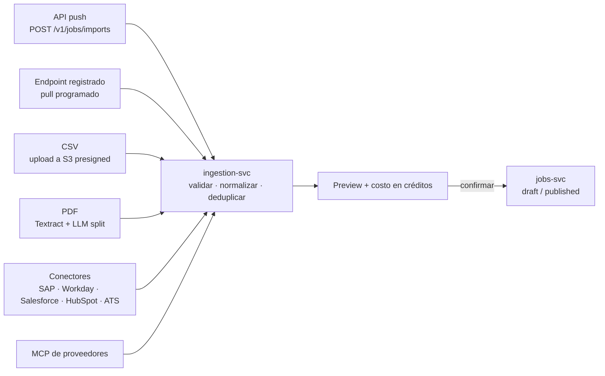
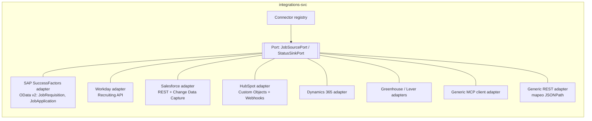
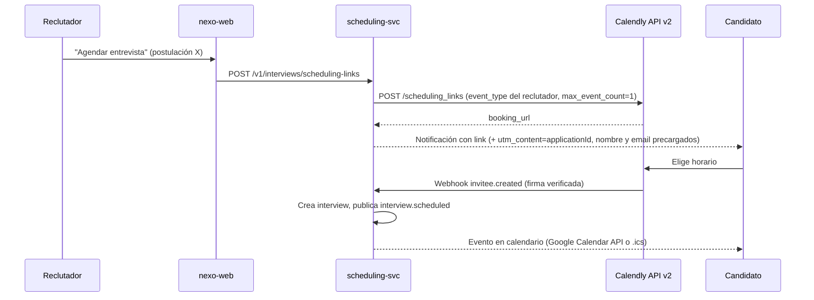

# 04 · Integraciones: ingesta de vacantes, ERP/CRM/ATS, MCP, Calendly y pagos

## 1. Modelo canónico de vacante

Toda fuente externa se traduce a `CanonicalJob` (JSON Schema en `nexo-specs/schemas/canonical-job.json`):

```json
{
  "externalId": "REQ-2026-0042",
  "source": { "type": "sap_successfactors", "connectionId": "conn_01H..." },
  "title": "Backend Engineer Node.js",
  "description": "...",
  "positions": 3,
  "location": { "country": "MX", "city": "CDMX", "modality": "hybrid" },
  "salary": { "min": 55000, "max": 75000, "currency": "MXN", "period": "month" },
  "employmentType": "full_time",
  "seniority": "senior",
  "skills": [{ "name": "Node.js", "level": 4, "mustHave": true }],
  "status": "open",
  "closesAt": "2026-12-31"
}
```

`(organization_id, source_type, external_id)` es **único**: reimportar actualiza (upsert) en lugar de duplicar.

## 2. Canales de ingesta (1 o N vacantes)



| Canal | Cómo funciona | Volumen |
|---|---|---|
| **API push** | `POST /v1/jobs/imports` con arreglo de 1..1,000 vacantes, header `Idempotency-Key`, auth API key o OAuth client credentials. Respuesta `202` con `importId`. | Alto |
| **Endpoint registrado (pull)** | El empleador registra URL, método, auth (API key/OAuth/Basic), formato (JSON/XML/RSS/HR-XML), mapeo de campos (JSONPath) y frecuencia (cron). Un worker hace *pull*, compara hash y aplica *upsert*. | Medio |
| **Webhook entrante** | URL única por conexión `POST /v1/hooks/{connectionId}` firmada con HMAC-SHA256. | Tiempo real |
| **CSV** | Plantilla descargable; upload a S3 con URL prefirmada; validación por fila (Zod) con reporte de errores descargable; preview editable. | 1..10,000 filas |
| **PDF** | Uno o varios PDFs; Textract si es escaneado; LLM segmenta en N vacantes y extrae campos con nivel de confianza; las de baja confianza quedan en `needs_review`. | 1..50 vacantes por PDF |
| **Formulario** | Alta manual con asistente IA que redacta la descripción y sugiere skills. | 1 |

**Estados de una importación:** `uploaded → parsing → validated → awaiting_confirmation → importing → completed | partially_failed | failed`.

**Cobro:** al confirmar, `billing-svc` reserva N créditos; si no alcanzan, se ofrece Stripe Checkout por la diferencia o guardar como `draft`.

## 3. Conectores empresariales (ACL + sincronización bidireccional)



- **Inbound (vacantes):** cada adaptador implementa `JobSourcePort.fetchChanges(since)` → `CanonicalJob[]`.
- **Outbound (estatus):** `StatusSinkPort.pushStatus(externalApplicationId, canonicalStatus)` con **tabla de mapeo de estatus** configurable por conexión (p. ej. `interview_scheduled` → SAP `Interview`).
- **Credenciales** en AWS Secrets Manager por conexión; OAuth con *refresh* automático.
- **Resiliencia:** reintentos exponenciales con *jitter*, *circuit breaker* (opossum), DLQ y panel de errores en `nexo-admin`; reproceso manual.
- **Idempotencia:** `sync_cursor` por conexión y `external_id`.
- **SDK de conectores:** interfaz pública para agregar adaptadores nuevos sin tocar el núcleo (marketplace en fase 3).

## 4. MCP de proveedores de vacantes

El admin registra un servidor MCP externo: URL, transporte, credenciales y **mapeo de tools** (`search` → `fetchChanges`, `create_posting` → multiposting). El adaptador `mcpc` lista las tools disponibles (`tools/list`), valida que existan las requeridas y ejecuta la ingesta como cualquier otro conector. Compatible con cualquier proveedor que exponga un servidor MCP estándar.

## 5. Calendly y calendarios



- **Reclutador:** conecta su cuenta Calendly por OAuth; elige el *event type* por defecto (p. ej. "Entrevista técnica 45 min").
- **Webhooks:** suscripción a `invitee.created` e `invitee.canceled` a nivel organización; firma verificada con el *signing key*; se correlaciona por el parámetro de tracking.
- **Candidato:**
  - Vista **Calendario de entrevistas** en la app (mes/semana/lista).
  - **Sincronización con Google Calendar** vía OAuth (scope `calendar.events`): se inserta/actualiza/cancela el evento automáticamente.
  - **Feed ICS** personal (`webcal://.../ics/{token}.ics`) para Outlook/Apple Calendar.
  - Recordatorios 24 h y 1 h antes por push/WhatsApp.
- Al agendarse, la postulación avanza automáticamente a `interview_scheduled` (y vuelve a `shortlisted` si se cancela).

## 6. Pagos (Stripe)

- **Stripe Checkout** para paquetes y suscripciones; **Customer Portal** para facturas y tarjetas.
- **Payment Intents** con 3-D Secure; tarjetas nunca tocan nuestros servidores (PCI SAQ A).
- Webhooks: `checkout.session.completed`, `payment_intent.succeeded`, `invoice.paid`, `customer.subscription.updated|deleted`, verificados con firma y procesados idempotentemente (`stripe_event_id` único).
- Ledger de créditos (`credit_ledger`) append-only: `+N` por compra, `−1` por publicación, reversos por reembolso.
- Facturación CFDI 4.0 (México) vía proveedor PAC en fase 2.
