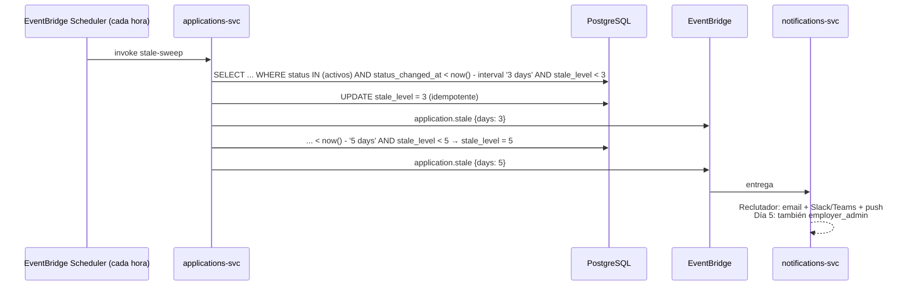
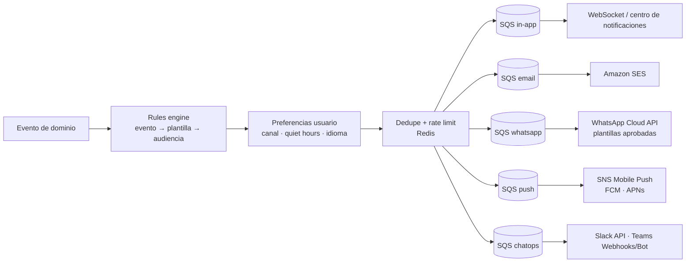

# 05 · Eventos de dominio y notificaciones

> **Estado (19/11/2026) · arquitectura objetivo de despliegue.** El MVP (monolito modular,
> [ADR-0001](adr/0001-monolito-modular-mvp.md)) **no tiene bus de eventos**. Los efectos que este documento modela como
> eventos ocurren hoy como llamadas en proceso:
>
> | Evento al desplegarse | Equivalente en el MVP |
> |---|---|
> | `application.status_changed` → notifications | `modules/applications/application/applications.ts` llama a `notifyUser` (in-app + email) |
> | `job.status_changed` (cierre) → applications, notifications | `modules/jobs/application/manage-jobs.ts` notifica a los candidatos con postulación activa |
> | `application.stale` (3 y 5 días, §3) | `staleDays` se calcula al leer los dashboards, sin EventBridge Scheduler |
> | Notificaciones omnicanal (§4) | Solo in-app (toasts) y email por el puerto `EmailSender` (log o Mailpit). WhatsApp, push y Slack quedan fuera de alcance |
>
> Al desplegarse, cada llamada se reemplaza por la publicación del evento con *outbox* y consumidores idempotentes, con el
> envelope y el catálogo de este documento. Los puertos y los esquemas por módulo permiten el cambio sin tocar el dominio.

## 1. Envelope de eventos (CloudEvents 1.0)

```json
{
  "specversion": "1.0",
  "id": "01JB7Z3K9V...",
  "source": "nexo.applications-svc",
  "type": "application.status_changed",
  "time": "2026-10-21T18:02:11Z",
  "subject": "application/01JB7Z...",
  "datacontenttype": "application/json",
  "dataschema": "https://specs.nexotalent.ai/events/application.status_changed/v1.json",
  "nexo": { "tenantId": "org_...", "correlationId": "...", "causationId": "...", "actor": "user_..." },
  "data": { "applicationId": "...", "jobId": "...", "candidateId": "...", "from": "in_review", "to": "shortlisted", "reason": null }
}
```

Reglas: eventos **inmutables y versionados** (`v1`, `v2`), sin PII sensible en `data` (solo IDs), consumidores **idempotentes** (tabla `processed_events(event_id)`), orden garantizado solo por `subject` mediante SQS FIFO donde importa (estatus de postulación).

## 2. Catálogo de eventos

| Evento | Productor | Consumidores |
|---|---|---|
| `user.registered` | identity | notifications |
| `job.publish_requested` | jobs | billing |
| `payment.succeeded` | billing | jobs, notifications |
| `job.published` | jobs | ai (embedding), applications (auto-apply), integrations (multiposting), notifications (alertas) |
| `job.status_changed` (`on_hold`, `filled`, `cancelled`, `expired`) | jobs | applications (cierra postulaciones abiertas), integrations, notifications |
| `resume.uploaded` | candidates | ai |
| `ai.resume_parsed` | ai | candidates, notifications |
| `application.submitted` | applications | jobs (contador), ai (screening), notifications, integrations |
| `application.status_changed` | applications | jobs, notifications, integrations, scheduling, realtime |
| `application.message_posted` | applications | notifications, realtime |
| `application.stale` (`days: 3 \| 5`) | applications | notifications |
| `interview.scheduled` / `interview.canceled` | scheduling | applications, notifications |
| `import.completed` | ingestion | notifications |
| `integration.sync_failed` | integrations | notifications (admin de org) |

Los esquemas viven en `nexo-specs/asyncapi/nexo-domain.yaml`.

## 3. Detección de postulaciones estancadas (3 y 5 días)



- Estatus activos: `submitted`, `in_review`, `shortlisted`, `interview_done`, `offer`.
- `stale_level` se reinicia a 0 en cada cambio de estatus.
- La notificación incluye **acciones rápidas**: "Cambiar estatus", "Escribir al candidato" (mensaje dentro de la postulación) o "Enviar email". Desde Slack/Teams se usan botones interactivos (Block Kit / Adaptive Cards) que llaman a un endpoint firmado.
- Umbrales configurables por organización (default 3 y 5).

## 4. Notificaciones omnicanal



### 4.1 Matriz de canales por audiencia

| Audiencia | In-app | Email | WhatsApp | Push Android/iOS | Slack | MS Teams |
|---|:-:|:-:|:-:|:-:|:-:|:-:|
| Candidato | ✅ | ✅ | ✅ (opt-in) | ✅ | — | — |
| Reclutador / empleador | ✅ | ✅ | opcional | ✅ | ✅ | ✅ |
| Admin plataforma | ✅ | ✅ | — | — | ✅ | — |

### 4.2 Notificaciones por paso del proceso

| Paso | Candidato | Empleador |
|---|---|---|
| Postulación enviada (manual o auto-apply) | Confirmación + score | Nuevo postulante (digest opcional) |
| En revisión | ✅ | — |
| Preseleccionado | ✅ + "pronto te contactarán" | — |
| Link de entrevista | ✅ con link Calendly | — |
| Entrevista agendada | ✅ + evento calendario | ✅ |
| Recordatorio entrevista (24 h / 1 h) | ✅ | ✅ |
| Entrevista realizada | ✅ | Recordatorio de scorecard |
| Oferta | ✅ | — |
| Contratado / No seleccionado | ✅ (con feedback opcional) | — |
| Vacante cerrada / on hold | ✅ a postulantes activos | ✅ confirmación |
| Mensaje en postulación | ✅ | ✅ |
| Estancada 3 / 5 días | — | ✅ |
| Importación completada | — | ✅ con resumen |
| Pago / factura | — | ✅ |

### 4.3 Detalles de implementación
- **Plantillas** MJML (email) y por canal en `notifications-svc/templates/{locale}/{event}.{channel}`; i18n `es-MX` y `en`.
- **WhatsApp:** solo plantillas aprobadas por Meta fuera de la ventana de 24 h; opt-in explícito y opt-out con "BAJA".
- **Push:** el móvil registra el token en `POST /v1/devices` (plataforma, token, app version); SNS crea el *endpoint*; tokens inválidos se purgan con el feedback de FCM/APNs.
- **Slack:** app OAuth por organización (scope `chat:write`), canal elegido por vacante o global.
- **Teams:** bot de Azure o Workflows webhook por canal; Adaptive Cards.
- **Quiet hours** por zona horaria del usuario (default 21:00–08:00 para WhatsApp/push no urgentes).
- Bitácora `notifications` con estado `queued | sent | delivered | failed | read`.
