# 06 · Modelo de datos

Motor: **Aurora PostgreSQL 16 + pgvector**. Un esquema por servicio (`identity`, `jobs`, `candidates`, `applications`, `ai`, `ingestion`, `integrations`, `scheduling`, `notifications`, `billing`). Las referencias **entre esquemas** son lógicas (IDs), sin FK física, para respetar la autonomía de cada servicio; dentro de un esquema sí hay FK. IDs tipo **ULID** (`text`, ordenables). Todas las tablas tienen `created_at` y `updated_at` (`timestamptz`, default `now()`); las de negocio incluyen `organization_id` para Row Level Security.

## 1. Diagrama entidad-relación

```mermaid
erDiagram
  ORGANIZATION ||--o{ MEMBERSHIP : "tiene"
  USER ||--o{ MEMBERSHIP : "pertenece"
  USER ||--o| CANDIDATE : "es"
  ORGANIZATION ||--o{ JOB : "publica"
  JOB ||--o{ JOB_SKILL : "requiere"
  SKILL ||--o{ JOB_SKILL : "en"
  CANDIDATE ||--o{ CANDIDATE_SKILL : "posee"
  SKILL ||--o{ CANDIDATE_SKILL : "en"
  CANDIDATE ||--o{ RESUME : "sube"
  CANDIDATE ||--o{ APPLICATION : "postula"
  JOB ||--o{ APPLICATION : "recibe"
  APPLICATION ||--o{ APPLICATION_STATUS_HISTORY : "registra"
  APPLICATION ||--o{ APPLICATION_MESSAGE : "contiene"
  APPLICATION ||--o{ INTERVIEW : "agenda"
  CANDIDATE ||--o{ AUTO_APPLY_RULE : "define"
  CANDIDATE ||--o{ MATCH_SCORE : "tiene"
  JOB ||--o{ MATCH_SCORE : "tiene"
  ORGANIZATION ||--o{ IMPORT_BATCH : "importa"
  IMPORT_BATCH ||--o{ IMPORT_ITEM : "contiene"
  ORGANIZATION ||--o{ INTEGRATION_CONNECTION : "configura"
  ORGANIZATION ||--o{ SUBSCRIPTION : "contrata"
  PLAN ||--o{ SUBSCRIPTION : "define"
  ORGANIZATION ||--o{ CREDIT_LEDGER : "acumula"
  ORGANIZATION ||--o{ PAYMENT : "paga"
  USER ||--o{ NOTIFICATION : "recibe"
  USER ||--o{ NOTIFICATION_PREFERENCE : "configura"
  USER ||--o{ DEVICE : "registra"

  ORGANIZATION {
    text id PK "ULID"
    text name "NOT NULL"
    text slug UK "NOT NULL"
    text tax_id "RFC, nullable"
    text country "ISO-3166, NOT NULL"
    text plan_tier "free|pro|business|enterprise"
    int stale_days_warning "default 3"
    int stale_days_escalation "default 5"
    timestamptz created_at
  }
  USER {
    text id PK "ULID"
    text cognito_sub UK "NOT NULL"
    text email UK "NOT NULL, citext"
    text full_name "NOT NULL"
    text phone_e164 "nullable"
    text locale "default es-MX"
    text timezone "default America/Mexico_City"
    text platform_role "user|platform_admin"
    text status "active|suspended|deleted"
    timestamptz created_at
  }
  MEMBERSHIP {
    text id PK
    text organization_id FK "NOT NULL"
    text user_id FK "NOT NULL"
    text role "recruiter|employer_admin"
    timestamptz created_at
  }
  JOB {
    text id PK
    text organization_id FK "NOT NULL"
    text created_by "user_id"
    text title "NOT NULL"
    text description "NOT NULL"
    text status "draft|pending_payment|published|on_hold|filled|cancelled|expired"
    text close_reason "nullable"
    int positions_total "NOT NULL, CHECK > 0"
    int positions_filled "default 0, CHECK <= positions_total"
    int applicants_count "default 0, desnormalizado"
    text modality "onsite|hybrid|remote"
    text country
    text city
    numeric salary_min
    numeric salary_max
    text currency "MXN|USD"
    text seniority "junior|mid|senior|lead"
    text source_type "manual|api|csv|pdf|sap|salesforce|mcp|..."
    text external_id "nullable"
    vector embedding "vector(1024)"
    timestamptz published_at
    timestamptz expires_at
  }
  SKILL {
    text id PK
    text name UK "NOT NULL"
    text category "language|framework|cloud|data|soft|idiom|domain|tool"
    text esco_uri "nullable"
    text_array aliases
    vector embedding "vector(1024)"
  }
  JOB_SKILL {
    text job_id PK,FK
    text skill_id PK,FK
    smallint level "0-5, NOT NULL"
    numeric weight "0-1, default 1"
    boolean must_have "default false"
  }
  CANDIDATE {
    text id PK
    text user_id FK,UK "NOT NULL"
    text headline
    text summary
    smallint years_experience
    text seniority
    text country
    text city
    text_array preferred_modalities
    numeric expected_salary_min
    text currency
    boolean open_to_work "default true"
    smallint profile_completeness "0-100"
    vector embedding "vector(1024)"
  }
  CANDIDATE_SKILL {
    text candidate_id PK,FK
    text skill_id PK,FK
    smallint level "0-5"
    numeric years
    text source "declared|extracted|verified"
    boolean confirmed "default false"
  }
  RESUME {
    text id PK
    text candidate_id FK "NOT NULL"
    text s3_key "NOT NULL"
    text mime_type
    text parse_status "pending|parsed|failed|needs_review"
    jsonb parsed_data
    boolean is_primary
  }
  APPLICATION {
    text id PK
    text job_id "ref jobs.job, NOT NULL"
    text candidate_id "ref candidates.candidate, NOT NULL"
    text organization_id "NOT NULL"
    text status "submitted|in_review|shortlisted|interview_scheduled|interview_done|offer|hired|rejected|withdrawn"
    text channel "manual|auto_apply|import"
    numeric match_score "0-100"
    text cover_note
    timestamptz status_changed_at "NOT NULL"
    smallint stale_level "0|3|5"
    text external_application_id
  }
  APPLICATION_STATUS_HISTORY {
    bigint id PK
    text application_id FK
    text from_status
    text to_status "NOT NULL"
    text changed_by "user_id o system"
    text reason
    timestamptz changed_at
  }
  APPLICATION_MESSAGE {
    text id PK
    text application_id FK
    text sender_user_id
    text body "NOT NULL, max 4000"
    timestamptz read_at
  }
  INTERVIEW {
    text id PK
    text application_id FK
    text calendly_event_uri UK
    text calendly_invitee_uri
    text scheduling_link_url
    timestamptz starts_at
    timestamptz ends_at
    text status "link_sent|scheduled|canceled|completed|no_show"
    text google_event_id
  }
  AUTO_APPLY_RULE {
    text id PK
    text candidate_id FK
    boolean active
    smallint min_match "default 75"
    text_array modalities
    text_array countries
    numeric min_salary
    smallint daily_cap "default 5"
    text_array excluded_org_ids
    timestamptz consent_at "NOT NULL"
  }
  MATCH_SCORE {
    text candidate_id PK
    text job_id PK
    numeric score "0-100"
    jsonb radar "ejes required vs candidate"
    jsonb factors
    text model_version
    timestamptz computed_at
  }
  IMPORT_BATCH {
    text id PK
    text organization_id FK
    text channel "api|endpoint|csv|pdf|connector|mcp"
    text status
    int total_items
    int succeeded
    int failed
    text idempotency_key UK
  }
  IMPORT_ITEM {
    text id PK
    text batch_id FK
    int row_number
    jsonb raw
    jsonb canonical
    numeric confidence
    text status "valid|invalid|needs_review|imported"
    jsonb errors
    text job_id
  }
  INTEGRATION_CONNECTION {
    text id PK
    text organization_id FK
    text provider "sap_sf|workday|salesforce|hubspot|dynamics|greenhouse|lever|rest|mcp"
    text secret_arn "Secrets Manager"
    jsonb field_mapping
    jsonb status_mapping
    text sync_cursor
    text schedule_cron
    text health "ok|degraded|failing"
  }
  PLAN {
    text id PK
    text code UK
    text billing_type "one_time|recurring"
    int price_cents
    text currency
    int job_credits
    int max_active_jobs
    jsonb features
    text stripe_price_id UK
  }
  SUBSCRIPTION {
    text id PK
    text organization_id FK
    text plan_id FK
    text stripe_subscription_id UK
    text status "active|past_due|canceled"
    timestamptz current_period_end
  }
  CREDIT_LEDGER {
    bigint id PK
    text organization_id FK
    int delta "positivo compra, negativo consumo"
    text reason "purchase|publish|refund|grant"
    text reference_id "job_id o payment_id"
    timestamptz created_at
  }
  PAYMENT {
    text id PK
    text organization_id FK
    text stripe_payment_intent_id UK
    int amount_cents
    text currency
    text status
  }
  NOTIFICATION {
    text id PK
    text user_id FK
    text event_type
    text channel "in_app|email|whatsapp|push|slack|teams"
    text status "queued|sent|delivered|failed|read"
    jsonb payload
    timestamptz sent_at
  }
  NOTIFICATION_PREFERENCE {
    text user_id PK,FK
    text event_type PK
    text_array channels
    time quiet_start
    time quiet_end
  }
  DEVICE {
    text id PK
    text user_id FK
    text platform "android|ios|web"
    text push_token UK
    text sns_endpoint_arn
    text app_version
  }
```



Tablas técnicas adicionales (no se muestran en el diagrama): `outbox_events` (por esquema), `processed_events`, `rag_chunks`, `ai_audit_log`, `consents`, `api_keys`.

## 2. Descripción de entidades principales

### `jobs.job` — Vacante
| Atributo | Tipo | Restricciones | Descripción |
|---|---|---|---|
| `id` | text | PK | ULID |
| `organization_id` | text | NOT NULL, FK → organization | Empresa dueña |
| `title` | text | NOT NULL, ≤ 160 | Título |
| `description` | text | NOT NULL | Descripción (markdown) |
| `status` | text | NOT NULL, CHECK en enum | Máquina de estados (ver 01-vision §6) |
| `close_reason` | text | nullable | Obligatorio si `filled`, `cancelled` u `on_hold` |
| `positions_total` | int | NOT NULL, CHECK > 0 | Posiciones disponibles |
| `positions_filled` | int | default 0, CHECK ≤ `positions_total` | Contrataciones registradas |
| `applicants_count` | int | default 0 | Contador actualizado por eventos |
| `source_type`, `external_id` | text | UNIQUE(`organization_id`,`source_type`,`external_id`) | Trazabilidad de origen |
| `embedding` | vector(1024) | índice HNSW `vector_cosine_ops` | Representación semántica |

Índices: `(organization_id, status)`, `(status, published_at DESC)` parcial `WHERE status='published'`, GIN `tsvector(title || description)`, HNSW en `embedding`.

### `candidates.candidate` — Candidato
Relación 1:1 con `user`. `embedding` se recalcula al cambiar skills o resumen. `profile_completeness` se calcula con reglas (foto opcional *no* suma, para no incentivar sesgo). Índice HNSW en `embedding`.

### `candidates.candidate_skill`
PK compuesta (`candidate_id`, `skill_id`). `source` distingue skill declarada, extraída por IA o verificada; solo las `confirmed = true` cuentan para matching.

### `applications.application` — Postulación
UNIQUE(`job_id`, `candidate_id`): un candidato no puede postular dos veces. `status_changed_at` y `stale_level` habilitan la detección de estancamiento con el índice parcial `(status_changed_at) WHERE status IN (activos)`. Cada cambio escribe en `application_status_history` y en `outbox_events` **en la misma transacción**.

### `applications.interview`
1:N con postulación (puede haber varias rondas). `calendly_event_uri` UNIQUE para idempotencia de webhooks.

### `ai.match_score`
PK (`candidate_id`, `job_id`). `radar` guarda `[{axis, required, candidate}]`; `factors` el desglose de la fórmula; `model_version` permite invalidar al cambiar el modelo.

### `billing.credit_ledger`
Append-only (sin UPDATE/DELETE por política). Saldo = `SUM(delta)` con vista materializada por organización.

### `ingestion.import_batch` / `import_item`
1:N. `idempotency_key` UNIQUE evita doble importación por reintentos del cliente.

### `integrations.integration_connection`
No guarda secretos, solo el ARN en Secrets Manager. `status_mapping` traduce estatus canónicos al del sistema externo.

## 3. Ejemplo de consulta de matching

```sql
SELECT j.id, j.title, 1 - (j.embedding <=> $1) AS similarity
FROM jobs.job j
WHERE j.status = 'published'
  AND j.country = $2
  AND j.modality = ANY($3)
ORDER BY j.embedding <=> $1
LIMIT 200;
-- re-ranking con la fórmula híbrida en ai-svc
```

`SET hnsw.ef_search = 100;` y `hnsw.iterative_scan = relaxed_order` (pgvector ≥ 0.8) para mantener recall con filtros.
