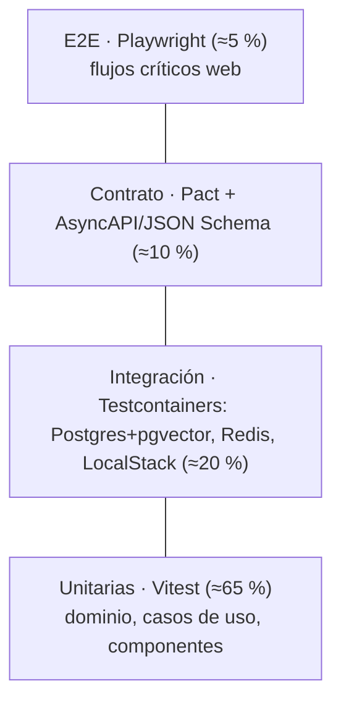

# 10 · Estrategia de testing (TDD y pirámide de pruebas)

## 1. Pirámide



Capas transversales: **evals de IA** (`nexo-evals`), **evals del harness**, **carga** (k6), **seguridad** (ZAP baseline, Semgrep), **visual y a11y** (Storybook + Playwright + axe).

## 2. TDD en backend

Ciclo **Red → Green → Refactor** por caso de uso, empezando por el dominio:

1. Escribir la prueba del caso de uso con *fakes* de los puertos (repositorio en memoria, publisher en memoria).
2. Implementar lo mínimo.
3. Refactorizar y agregar la prueba de integración del adaptador real.

Ejemplo (`applications-svc`):

```ts
describe('ChangeApplicationStatus', () => {
  it('rechaza transición inválida hired → in_review', async () => {
    const app = anApplication({ status: 'hired' });
    const repo = new InMemoryApplicationRepo([app]);
    const uc = new ChangeApplicationStatus(repo, new InMemoryOutbox(), fixedClock);
    await expect(uc.execute({ id: app.id, to: 'in_review', actor: recruiter }))
      .rejects.toThrow(InvalidTransitionError);
  });

  it('reinicia stale_level y publica application.status_changed en el outbox', async () => {
    const app = anApplication({ status: 'in_review', staleLevel: 3 });
    const outbox = new InMemoryOutbox();
    await new ChangeApplicationStatus(new InMemoryApplicationRepo([app]), outbox, fixedClock)
      .execute({ id: app.id, to: 'shortlisted', actor: recruiter });
    expect(outbox.events).toContainEqual(expect.objectContaining({ type: 'application.status_changed' }));
  });
});
```

## 3. Matriz por servicio

| Servicio | Unitarias clave | Integración | Contrato |
|---|---|---|---|
| jobs | Máquina de estados, `positions_filled ≤ total`, reglas de cierre | Repo Drizzle + índices, outbox | OpenAPI provider (Pact) |
| applications | Transiciones, unicidad, stale sweep (reloj inyectado), auto-apply cap | Sweep con datos de 2/3/5/6 días | Eventos vs. AsyncAPI |
| ai | Fórmula de score, agrupación de radar, normalización de skills | pgvector HNSW con fixtures, Bedrock *stub* | `JobMatch` schema |
| ingestion | Parser CSV, validación por fila, dedupe, segmentación PDF (LLM *mock*) | S3 LocalStack, archivo de 10k filas | Import API |
| integrations | Mapeo de estatus, circuit breaker | Adaptador SAP contra servidor OData *mock* (WireMock) | — |
| scheduling | Correlación por tracking, idempotencia | Webhook Calendly firmado | — |
| notifications | Reglas, preferencias, quiet hours, dedupe | SES/SNS LocalStack | Plantillas snapshot |
| billing | Ledger, saldo, reservas | Webhooks Stripe (stripe-mock) | — |

## 4. Frontend y design system

| Nivel | Herramienta | Qué se prueba |
|---|---|---|
| Unit | Vitest + Testing Library | Hooks (`useJobMatch`), utilidades, transformación de datos del radar. |
| Componente | Storybook *interaction tests* (play functions) con Vitest | `ApplicationStepper` en cada estado, `KanbanBoard` drag & drop, `FileDropzone`. |
| Accesibilidad | `@storybook/addon-a11y` (axe) en CI | 0 violaciones serias en todas las historias. |
| Visual | Playwright `toHaveScreenshot` sobre Storybook (dark/light, desktop/móvil) | Regresiones de estilo de `SkillRadarChart`, `JobCard`. |
| Integración | MSW (mocks de API generados desde OpenAPI) | Páginas completas con datos. |
| E2E | Playwright contra entorno *staging* efímero | Ver §5. |

## 5. Flujos E2E críticos

1. Candidato importa CV → confirma skills → busca → ve radar → postula → ve stepper "Postulado".
2. Empleador crea vacante → paga con tarjeta de prueba Stripe → vacante publicada con contador de posiciones.
3. Empleador importa CSV de 3 vacantes → preview → confirma → 3 publicadas.
4. Reclutador mueve candidato a "Preseleccionado" → envía link Calendly → webhook simulado → stepper "Entrevista agendada".
5. Reloj simulado +5 días → empleador recibe recordatorio (verificado en Mailpit).
6. Reclutador cierra vacante como "Ocupada" → postulantes activos notificados.
7. Admin suspende usuario → sesión invalidada.

## 6. No funcionales
- **Carga (k6):** `GET /v1/bff/candidate/dashboard` p95 < 300 ms a 200 RPS; búsqueda semántica p95 < 500 ms.
- **Resiliencia:** inyección de fallas (Slack 500, Bedrock *throttling*) → evento a DLQ, sin pérdida.
- **Seguridad:** OWASP ZAP baseline en staging; tests de autorización cruzada entre *tenants*.

## 7. Cobertura y quality gates (CI)
- Cobertura de líneas ≥ 80 % en dominio y casos de uso (no se persigue en adaptadores).
- *Mutation testing* (Stryker) mensual en `applications` y `ai` (≥ 60 %).
- PR bloqueado si fallan unit, integración, contrato, a11y, evals de IA o el análisis estático.
