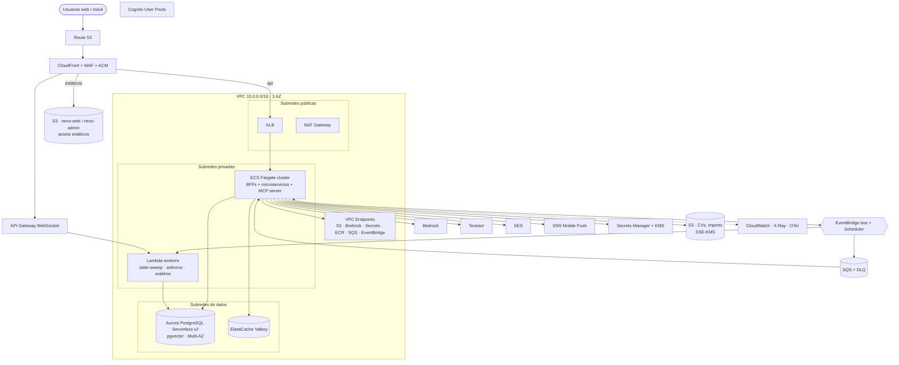

# 11 · Infraestructura y despliegue en AWS

## 1. Diagrama



## 2. Entornos

| Entorno | Cuenta AWS | Propósito | Despliegue |
|---|---|---|---|
| `dev` | nexo-dev | Integración continua | Automático en merge a `main` |
| `preview` | nexo-dev | Entorno efímero por PR (frontends + BFF) | Por PR, destruido al cerrar |
| `staging` | nexo-staging | E2E, carga, demo | Automático tras `dev` verde |
| `prod` | nexo-prod | Producción | Manual con aprobación + *canary* |

Organización con AWS Organizations, SSO (IAM Identity Center), SCPs que impiden desactivar CloudTrail o crear recursos fuera de `us-east-1` / `us-east-2` (o la región elegida con Bedrock disponible).

## 3. IaC (`nexo-infra`, AWS CDK TypeScript)

```
nexo-infra/
├── bin/nexo.ts
├── lib/
│   ├── network-stack.ts        # VPC, subredes, endpoints
│   ├── data-stack.ts           # Aurora, Valkey, S3, KMS
│   ├── identity-stack.ts       # Cognito
│   ├── messaging-stack.ts      # EventBridge, SQS, DLQ, Scheduler, SES, SNS
│   ├── compute-stack.ts        # ECS cluster, ALB, servicios (construct reutilizable)
│   ├── edge-stack.ts           # CloudFront, WAF, Route 53, S3 web
│   ├── ai-stack.ts             # permisos Bedrock, Textract, guardrails
│   ├── observability-stack.ts  # dashboards, alarmas, X-Ray
│   └── constructs/nexo-service.ts
├── config/{dev,staging,prod}.ts
└── test/*.test.ts              # snapshot + assertions de CDK
```

`NexoService` (construct) crea por servicio: task definition, servicio Fargate con autoscaling (CPU 60 % y longitud de cola SQS), target group, rol IAM de mínimo privilegio, colas consumidoras con DLQ, reglas de EventBridge y alarmas.

## 4. CI/CD (GitHub Actions por repo)

```mermaid
flowchart LR
  pr[Pull request] --> lint[Lint + typecheck]
  lint --> unit[Unit]
  unit --> integ[Integración<br/>Testcontainers]
  integ --> contract[Contrato<br/>Pact broker]
  contract --> evals[Evals IA<br/>si cambia prompts/ai]
  evals --> sec[Semgrep · gitleaks · Trivy]
  sec --> build[Build imagen<br/>ECR · firma]
  build --> dev[Deploy dev]
  dev --> e2e[E2E staging]
  e2e --> approve{Aprobación}
  approve --> canary[Prod canary 10 %<br/>ECS blue/green CodeDeploy]
  canary --> full[100 %]
  canary -.rollback automático por alarmas.-> prev[Versión anterior]
```



- Autenticación **OIDC** de GitHub a roles IAM por repo y entorno.
- Frontends: `vite build` → S3 versionado → invalidación de CloudFront; *preview URLs* por PR.
- Migraciones: tarea ECS `migrate` (Drizzle) ejecutada antes del despliegue; migraciones *expand/contract* para cero downtime.
- Workflows reutilizables en `nexo-workspace/.github/workflows/` (`service-ci.yml`, `frontend-ci.yml`).

## 5. Observabilidad
- **OpenTelemetry** SDK en cada servicio → X-Ray (trazas) y CloudWatch (métricas/logs); `correlationId` propagado de HTTP a eventos.
- **Langfuse** (autohospedado en ECS) para trazas de LLM: prompts, costo, latencia, evaluaciones online.
- Dashboards: RED por servicio, profundidad de colas/DLQ, tokens y costo de IA, funnel de negocio.
- Alarmas: 5xx > 1 %, p95 > SLO, DLQ > 0, costo de Bedrock > presupuesto diario.

## 6. Costos estimados (staging del proyecto final)
Aurora Serverless v2 (0.5–2 ACU), 4–6 tareas Fargate pequeñas (0.25 vCPU), Valkey t4g.micro, NAT Gateway y Bedrock por consumo. Para reducir costo en la demo: un solo NAT, servicios agrupados en menos tareas, *scale to zero* nocturno y AWS Budgets con alertas.

## 7. Recuperación ante desastres
RPO 5 min (PITR Aurora), RTO 1 h; backups cross-region semanales; *runbooks* en `nexo-specs/runbooks/`.
