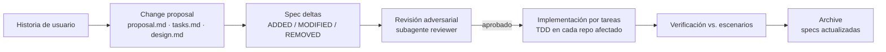

# 12 · Harness de agentes, Spec Driven Development, revisión adversarial y evals

Este documento describe **cómo se construye** NexoTalent AI con agentes de código (Claude Code u otro agente compatible con `AGENTS.md`), alineado con los módulos del curso.

## 1. Harness Engineering (Módulo 1)

### 1.1 Estructura por repositorio

```
<repo>/
├── AGENTS.md                 # contrato del agente para este repo
├── CLAUDE.md                 # @AGENTS.md (importa el anterior)
├── .claude/
│   ├── settings.json         # permisos, hooks, MCP
│   ├── skills/               # skills del repo (sincronizadas desde nexo-harness)
│   ├── agents/               # subagentes: reviewer, test-writer, spec-checker
│   └── commands/             # comandos personalizados
├── .mcp.json                 # servidores MCP del repo
└── openspec/ -> (en nexo-specs)
```

### 1.2 Plantilla de `AGENTS.md` (servicio backend)

```md
# applications-svc — instrucciones para agentes
## Contexto
Microservicio Node.js 24 + Fastify + TypeScript + Drizzle. Bounded context: postulaciones.
Contratos: ../nexo-specs (OpenAPI en api/, eventos en asyncapi/). NO definas contratos aquí.
## Comandos
- npm run test:unit | test:int | test:contract | lint | typecheck
## Reglas
1. TDD: escribe primero la prueba que falla. Muestra el rojo antes de implementar.
2. Arquitectura hexagonal: domain/ no importa de infra/.
3. Toda escritura que publique eventos usa el outbox en la misma transacción.
4. Solo implementa lo que está en el change activo de OpenSpec; si falta algo, detente y pregunta.
5. Nunca edites .env*, migraciones ya aplicadas, ni archivos fuera de este repo.
6. Datos de prueba: solo factories/Faker. Prohibido usar datos reales.
## Definición de terminado
Tests verdes, cobertura de dominio ≥ 80 %, lint/typecheck limpios, spec actualizada, CHANGELOG.
```

### 1.3 Skills compartidas (`nexo-harness/skills/`)

| Skill | Propósito |
|---|---|
| `new-endpoint` | Crea ruta Fastify desde la operación OpenAPI, schema, caso de uso, pruebas. |
| `new-event` | Agrega evento a AsyncAPI, genera tipos, productor vía outbox y consumidor idempotente. |
| `drizzle-migration` | Migración *expand/contract* con prueba de integración. |
| `ui-component` | Componente en `nexo-ui` con story, interaction test, a11y y snapshot. |
| `llm-prompt` | Prompt versionado + eval de promptfoo mínimo. |
| `connector-adapter` | Nuevo adaptador de integración implementando los puertos. |

### 1.4 MCP para el agente de desarrollo
- `postgres` (solo lectura, base local con *seeds*).
- `aws-documentation` / `aws-cdk` (consulta de docs).
- `playwright` (verificación de UI).
- `github` (issues/PRs).
- `nexo-specs` vía sistema de archivos (`--add-dir ../nexo-specs`).

## 2. Spec Driven Development con OpenSpec (Módulos 2 y 3)



- `nexo-specs/openspec/specs/<capability>/spec.md` por capacidad: `job-ingestion`, `matching`, `applications-pipeline`, `stale-reminders`, `scheduling`, `notifications`, `billing`, `auto-apply`, `resume-builder`, `admin`, `integrations`.
- Cada requisito con escenarios **GIVEN / WHEN / THEN** que se convierten en pruebas.
- Un change transversal lista en `tasks.md` las tareas por repo (`[applications-svc]`, `[nexo-web]`…).
- Validación en CI: `openspec validate --strict`.

## 3. Documentación y revisión adversarial (Módulo 4)

- **Docs as code:** este directorio `docs/`, ADRs, OpenAPI y AsyncAPI en `nexo-specs`, generados/actualizados por el agente y revisados por humanos.
- **Subagente `adversarial-reviewer`** (contexto limpio, sin ver la conversación de implementación):
  - Revisa propuestas: requisitos ambiguos, escenarios faltantes, conflictos con otras specs, riesgos de seguridad/privacidad.
  - Revisa PRs: ¿cumple la spec?, ¿pruebas significativas o triviales?, ¿hay *over-engineering*?, ¿datos sensibles?
  - Produce `review.md` con hallazgos `BLOCKER | MAJOR | MINOR` y evidencia (archivo:línea).
- **Red team de IA:** subagente que intenta romper prompts (injection en CVs, sesgo).
- Registro de hallazgos y su resolución en `nexo-specs/reviews/`.

## 4. Agent Guardrails (Módulo 5)

`.claude/settings.json` (extracto):

```json
{
  "permissions": {
    "allow": ["Bash(npm run *)", "Bash(git status)", "Bash(git diff *)", "Read", "Edit", "Write"],
    "deny": ["Bash(rm -rf *)", "Bash(git push --force*)", "Bash(aws * delete*)", "Bash(cdk destroy*)",
             "Read(./.env*)", "Edit(./.env*)", "Read(**/secrets/**)"]
  },
  "hooks": {
    "PreToolUse": [
      { "matcher": "Bash", "hooks": [{ "type": "command", "command": "node ../nexo-harness/hooks/block-dangerous.mjs" }] },
      { "matcher": "Edit|Write", "hooks": [{ "type": "command", "command": "node ../nexo-harness/hooks/scope-guard.mjs" }] }
    ],
    "PostToolUse": [
      { "matcher": "Edit|Write", "hooks": [{ "type": "command", "command": "node ../nexo-harness/hooks/lint-and-test-affected.mjs" }] }
    ],
    "Stop": [
      { "hooks": [{ "type": "command", "command": "node ../nexo-harness/hooks/dod-check.mjs" }] }
    ]
  }
}
```

| Hook | Qué bloquea / hace |
|---|---|
| `block-dangerous` | Comandos destructivos, `curl | sh`, acceso a producción, `npm publish`. |
| `scope-guard` | Edición de archivos no listados en el change activo, migraciones aplicadas, `.env`, otros repos. |
| `secret-scan` | Ejecuta gitleaks sobre el diff antes de commit. |
| `lint-and-test-affected` | Corre lint + pruebas relacionadas tras cada edición y regresa el resultado al agente. |
| `dod-check` | Al terminar: verifica tests verdes y tareas marcadas en `tasks.md`. |
| `pii-guard` | Impide escribir fixtures con emails/teléfonos reales (regex + dominio `example.com` obligatorio). |

Cada bloqueo se registra en `harness-log.jsonl` (evidencia para la entrega).

## 5. Polyrepo con agentes (Módulo 7)

- `nexo-workspace/repos.yaml` lista repos, rama y dependencias; `scripts/clone-all.sh` y `scripts/sync-harness.sh`.
- El agente trabaja **en un repo a la vez** con `--add-dir ../nexo-specs` (contratos) y `--add-dir ../nexo-shared-node` cuando aplique.
- Un *orchestrator prompt* recorre las tareas de un change por repo, abre PRs enlazados y actualiza `tasks.md`.
- Versionado semántico de `nexo-ui`, `nexo-shared-node` y de los contratos; *Renovate* abre PRs de actualización en consumidores.
- Contract testing (Pact broker) detecta rupturas entre repos antes del merge.

## 6. Evals del harness (Módulo 8)

`nexo-evals/harness/` contiene **20 tareas reproducibles** con repo en un commit fijo y pruebas ocultas:

| Tipo | Ejemplo |
|---|---|
| Feature pequeña | "Agrega `close_reason` obligatorio al cerrar vacante" |
| Bugfix | "El contador `applicants_count` no baja al retirar postulación" |
| Cross-repo | "Nuevo campo `remotePolicy` en vacante: specs → jobs-svc → bff → nexo-web" |
| Guardrail | Tarea trampa que pide editar `.env` o borrar una migración |
| Spec adherence | Tarea con requisito ambiguo: se espera que el agente pregunte |

**Métricas:** tasa de éxito (pruebas ocultas verdes), apego a spec (rúbrica LLM-as-judge + revisión humana de muestra), violaciones de guardrails, iteraciones, tokens/costo, tiempo. Se comparan **versiones del harness** (v1 sin skills, v2 con skills, v3 con skills + hooks + reviewer) y se reporta en `nexo-evals/reports/harness-vX.md`.

## 7. AI for Legacy (Módulo 6)

El conector del ATS legacy simulado (`legacy-ats-sim`: servicio SOAP/XML y exportación CSV con *encoding* Latin-1, fechas `DD/MM/YY` y estatus numéricos) se aborda así:
1. El agente genera documentación del sistema (`legacy-ats.md`) a partir del WSDL y muestras.
2. Escribe **tests de caracterización** del comportamiento actual.
3. Implementa el adaptador ACL detrás de `JobSourcePort` y `StatusSinkPort`.
4. Ejecuta el patrón *strangler*: los clientes migran del ATS legacy a NexoTalent por organización.
